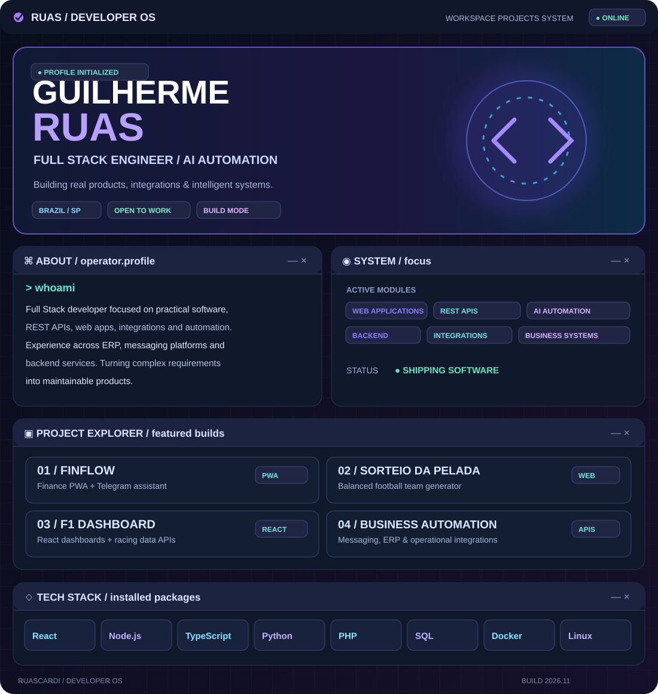

<div align="center">



<br/>

[](https://github.com/RuasCardi)
[](https://www.linkedin.com/in/guilherme-cardinalli-b28634363/)
[](mailto:cardinalliruas@gmail.com)

</div>

### `▣ /workspace/about-me`

```yaml
operator: Guilherme Ruas
role: Full Stack Developer
location: Campinas, SP · Brazil
specialties:
  - Web applications & REST APIs
  - Business systems & integrations
  - AI-powered automation
  - Backend architecture & databases
mission: "Build useful software, not just interfaces."
```

### `◈ /workspace/projects`

<table>
<tr><td width="50%" valign="top">

#### 💸 FinFlow
**Personal finance PWA**

Track income, expenses, schedules and financial insights, with Telegram bot integration.

**Web App · PWA · Automation**

[↗ Launch FinFlow](https://fin-flow-umber.vercel.app/agenda)

</td><td width="50%" valign="top">

#### ⚽ Sorteio da Pelada
**Balanced football team generator**

Create more balanced teams using player ratings and automated draws.

**Web App · Team Management**

[↗ Open app](https://sorteioda-pelada.vercel.app/login)

</td></tr>
<tr><td width="50%" valign="top">

#### 🏎️ F1 Dashboard
**Motorsport data visualization**

Explore Formula 1 information through API integrations and React dashboards.

**React · APIs · Data Visualization**

</td><td width="50%" valign="top">

#### ⚙️ Business Automation
**Integrations & real-world systems**

Experience building messaging workflows, REST APIs, ERP features and operational tools.

**Node.js · PHP · Python · SQL**

</td></tr>
</table>

### `⌘ /workspace/tech-stack`

<div align="center">


</div>

### `▥ /workspace/telemetry`

<div align="center">


</div>

### `> connect --with ruas`

<div align="center">

**Have a project, integration or automation challenge?**

[LinkedIn](https://www.linkedin.com/in/guilherme-cardinalli-b28634363/) · [Email](mailto:cardinalliruas@gmail.com) · [GitHub](https://github.com/RuasCardi)

<sub>DEVELOPER OS / profile edition · Designed to run inside GitHub README</sub>

</div>
